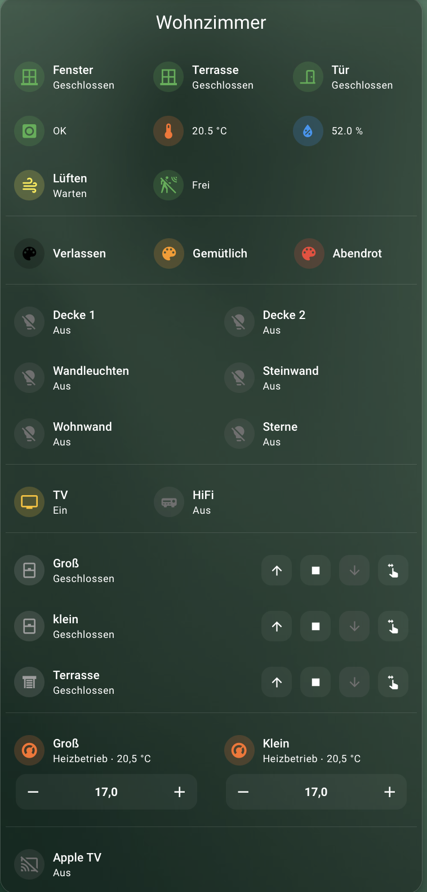

# SHFD Raumkarte

[English](../room-card.md) · [Deutsch](room-card.md)

Eine konfigurierbare Home-Assistant-Raumkarte mit visuellem Editor. Kombiniere Raumstatus, Beleuchtung, Szenen, Schalter, Rollläden, Thermostate, Mediaplayer, Wecker und eigene Bereiche. Leere Bereiche und Einträge ohne Entität werden ausgeblendet.



## Installation

Installiere [Mushroom](https://github.com/piitaya/lovelace-mushroom) und [UIX](https://github.com/Lint-Free-Technology/uix). Registriere den Collection-Einstiegspunkt als JavaScript-Modul-Ressource:

```text
/hacsfiles/ha-card-collection/ha-card-collection.js
```

Für eine manuelle Installation:

```text
/local/ha-card-collection/ha-card-collection.js
```

Registriere `raumkarte.js` bei dieser Installation nicht zusätzlich. Der visuelle Editor ist enthalten; eine separate Editor- oder Farberweiterungsdatei ist nicht erforderlich. Lade die komplette Browser-Seite nach Ressourcenänderungen neu.

## Karte hinzufügen

Wähle **SHFD Raumkarte** im Kartenwähler oder verwende YAML:

```yaml
type: custom:raum-karte
raum: Wohnzimmer
status_items:
  - entity: binary_sensor.wohnzimmer_fenster
    name: Fenster
    kind: window
lampen:
  - entity: light.wohnzimmer_decke
    name: Deckenlicht
```

## Konfiguration

| Option | Beschreibung |
| --- | --- |
| `raum` | Raumtitel; erforderlich |
| `anwesenheit` | Optionale Personen-Entität für die Anwesenheitsanzeige |
| `title_color` | Dynamische Titelfarben |
| `layout` | Reihenfolge, Spalten und Sichtbarkeit |
| `status_items` | Statusanzeigen und Messwerte |
| `wecker` | Wecker und optionale Lichtwecker-Automatisierungen |
| `szenen` | Szenen |
| `lampen` | Lampen |
| `schalter` | Schalter |
| `rolllaeden` | Rollläden und Abdeckungen |
| `thermostate` | Klima-Entitäten |
| `mediaplayer` | Mediaplayer |
| `custom_sections` | Eigene Bereiche mit frei auswählbaren Entitäten |

Ein Eintrag benötigt eine `entity`, um angezeigt zu werden. Leere Einträge sind während der Bearbeitung erlaubt. Die meisten Bereiche unterstützen einen optionalen `name`. Die YAML-Schlüssel bleiben auch bei englischer Dokumentation unverändert.

## Eigene Bereiche

```yaml
custom_sections:
  - key: sensoren
    title: Sensoren
    domain: sensor
    columns: 3
    items:
      - entity: sensor.wohnzimmer_temperatur
        name: Temperatur
        icon: mdi:thermometer
        icon_color: "#FFB74D"
```

| Option | Beschreibung |
| --- | --- |
| `key` | Eindeutiger, nicht leerer Bereichsschlüssel; darf keinem festen Bereich entsprechen |
| `title` | Erforderlicher Name für Editor und Layout; keine Überschrift im Dashboard |
| `domain` | Optionaler Domain-Filter für die Entitätsauswahl; weglassen oder `""` für Beliebig |
| `columns` | Standard-Spaltenanzahl von 1 bis 6; Vorgabe 3 |
| `visible` | Standard-Sichtbarkeit; Vorgabe `true` |
| `items` | Einträge mit `entity` und optional `name`, `icon`, `icon_color` |

Eigene Bereiche erscheinen ohne Bereichstitel und Bereichs-Icon, wie die festen Bereiche. Jeder eigene Bereich kann im Layout einzeln zwischen feste Bereiche verschoben werden.

Der Domain-Filter begrenzt nur die Auswahl im Editor: `light` bietet Lichter, `scene` Szenen und `sensor` Sensoren an. Bereits konfigurierte Einträge werden beim Filterwechsel nicht gelöscht. Der Filter ändert weder die Darstellung noch die Bedienaktion: Eigene Einträge verwenden generische Mushroom-Entitätskarten und öffnen beim Antippen die Detailansicht. Für spezialisierte Licht-, Szenen- oder Rollladenbedienung verwende die festen Bereiche.

## Layout

Der Kopf bleibt an erster Stelle. Feste Schlüssel sind `status_items`, `wecker`, `szenen`, `lampen`, `schalter`, `rolllaeden`, `thermostate` und `mediaplayer`; hinzu kommen die `key`-Werte eigener Bereiche.

```yaml
layout:
  order:
    - status_items
    - sensoren
    - lampen
    - szenen
  sections:
    sensoren:
      columns: 2
    wecker:
      visible: false
```

`sensoren` muss zuvor unter `custom_sections` definiert sein. Nicht in `order` genannte Bereiche werden anschließend in Standardreihenfolge ergänzt. Jeder Schlüssel darf nur einmal vorkommen. `layout.sections.<key>.columns` und `.visible` überschreiben die Bereichsvorgaben. Versteckte Bereiche behalten ihre Einträge; leere Bereiche bleiben auch bei `visible: true` unsichtbar.

Im Editor: **Layout → Nach oben / Nach unten → Layout übernehmen**. Titelfarbänderungen werden mit **Farbregeln übernehmen** gespeichert; Statusfarben und Messwertbereiche werden direkt in die Konfiguration übernommen.

## Statusarten und Zustände

| `kind` | Technische Zustände / Werte | Darstellung |
| --- | --- | --- |
| `window` | `on` = offen, `off` = geschlossen | Icon und Farbe pro Zustand |
| `door` | `on` = offen, `off` = geschlossen | Icon und Farbe pro Zustand |
| `motion` | `on` = erkannt, `off` = keine Bewegung / abwesend | Icon und Farbe pro Zustand |
| `smoke` | `on` = Alarm, `off` = OK | Icon und Farbe pro Zustand |
| `lock` | `locked`, `unlocked`, `locking`, `unlocking`, `jammed`, `open`, `opening` | Icon und Farbe pro Zustand |
| `ventilation` | `wait`, `ventilate`, `ok`, `do_not_ventilate`, `close` | Festes Icon und Farbe pro Zustand |
| `temperature` | Numerischer Messwert | Festes Icon und wertabhängige Farbe |
| `humidity` | Numerischer Messwert | Festes Icon und wertabhängige Farbe |

Die Lüftungszustände sind die von dieser Karte vorgesehenen Schlüssel; die tatsächlichen Zustände hängen vom verwendeten Sensor ab. Weitere Zustände können über YAML unter `states` ergänzt werden, sind aber nicht als zusätzliche Zeilen im visuellen Editor verfügbar. Für die Lüftungsempfehlung bleibt das Icon unabhängig vom Zustand fest.

### Zustandsabhängige Icons und Farben

```yaml
status_items:
  - entity: binary_sensor.wohnzimmer_fenster
    name: Fenster
    kind: window
    states:
      "on":
        label: Offen
        icon: mdi:window-open-variant
        color: "#EF9A9A"
      "off":
        label: Geschlossen
        icon: mdi:window-closed-variant
        color: "#A5D6A7"
```

`label`, `icon` und `color` sind optional. Ohne Überschreibung bleiben die automatischen Vorgaben erhalten. Ein explizites `color: ""` bedeutet neutral. Ein festes `icon` bzw. `icon_color` auf Eintragsebene hat Vorrang vor den entsprechenden Zustandsregeln; entferne eine feste Überschreibung, wenn die Zustandsregeln greifen sollen. Die Fehleranzeige hat weiterhin Vorrang vor benutzerdefinierten Farben.

### Unbekannt und nicht verfügbar

Für alle Einträge unter `status_items` gelten automatisch:

- `unknown`: Text Unbekannt.
- `unavailable`: Text Nicht verfügbar.
- Beide: graues Haupticon und rotes Ausrufezeichen-Badge (`mdi:exclamation-thick`).

Ungültige nichtnumerische Messwerte werden nicht als `0` in die Messwert-Farblogik eingespeist. Das Warn-Badge kennzeichnet die Zustände `unknown` und `unavailable`; ein beliebiger anderer ungültiger Messwert erhält dadurch nicht automatisch ein Badge.

## Messwertfarben

Temperatur und Luftfeuchtigkeit verwenden einen Grundbereich und inklusive Untergrenzen wie die Klima-Karte:

```yaml
status_items:
  - entity: sensor.wohnzimmer_temperatur
    name: Temperatur
    kind: temperature
    icon: mdi:thermometer
    colors_enabled: true
    ranges:
      - above: null
        color: "#90CAF9"
      - above: 18
        color: "#A5D6A7"
      - above: 24
        color: "#FFE082"
      - above: 26
        color: "#FFB74D"
```

- Genau ein `above: null` definiert den Grundbereich unterhalb aller passenden Untergrenzen.
- Jede numerische Untergrenze darf nur einmal vorkommen.
- Die höchste passende Untergrenze gewinnt unabhängig von der Listenreihenfolge. `above: 18` gilt bereits bei genau 18.
- Im Beispiel: unter 18 blau, ab 18 grün, ab 24 gelb, ab 26 orange.
- `color: ""` bedeutet neutral.
- `colors_enabled: false` schaltet die Messwertfarben ab, ohne Regeln zu löschen; unbekannte/nicht verfügbare Werte bleiben grau.

Ohne `ranges` gelten diese Standardfarben:

| Messwert | Grundbereich | Weitere Untergrenzen |
| --- | --- | --- |
| Temperatur | `#90CAF9` | 18: `#A5D6A7`, 24: `#FFE082`, 26: `#FFB74D`, 28: `#EF9A9A` |
| Luftfeuchtigkeit | `#90CAF9` | 40: `#A5D6A7`, 70: `#FFE082`, 85: `#FFB74D` |

Grenzen werden mit dem numerischen Sensorwert verglichen; eine Einheitenumrechnung findet nicht statt. Die Temperaturvorgaben sind für °C, die Feuchtigkeitsvorgaben für relative Feuchte in % gedacht. Passe Grenzen bei anderen Einheiten an. Die Farben sind Darstellungshilfen, keine Gesundheits- oder Schimmelbewertung.

Im Editor kannst du Bereiche hinzufügen, Untergrenzen und Farben ändern sowie Standardfarben wiederherstellen. Der einzige Grundbereich kann nicht entfernt werden. Ältere YAML-Regeln mit `below`, `from` und `to` bleiben wirksam; ihre bisherige Reihenfolge bleibt relevant. Der Editor weist darauf hin. **Standardfarben wiederherstellen** ersetzt sie durch das neue Schema und entfernt eine ältere feste `icon_color`-Überschreibung.

## Einheitliche Farbauswahl

Titelfarben, Statusfarben, Messwertbereiche, Szenen und eigene Einträge bieten ein Farbfeld mit nativem Color-Picker und daneben eine Texteingabe. CSS-Farben wie Hex-Werte, Farbnamen, `rgb(...)`, `hsl(...)` und einfache Theme-Variablen können eingegeben werden. Hex-Werte in YAML immer in Anführungszeichen setzen.

Leere Farben haben je nach Feld unterschiedliche Bedeutung: In Status-Zustandsregeln und Messwertbereichen bedeutet leer neutral; bei optionalen festen Überschreibungen entfällt die Überschreibung. Szenen verwenden ohne `icon_color` wieder ihre Standardfarbe.

## Titelfarben

```yaml
title_color:
  room_label: Wohnzimmer
  default: "var(--primary-text-color)"
  rules:
    - label: Hauptbeleuchtung
      color: "#FFD600"
```

Die erste Regel gewinnt, deren Label zu einer eingeschalteten Lampe mit dem Raumlabel passt. Ohne `room_label` wird der Raumname verwendet. Bei keiner passenden Regel gilt `default`.

## Wecker

Wecker-Entitäten müssen `hour` und `minute` bereitstellen:

```yaml
wecker:
  - entity: input_datetime.schlafzimmer_wecker
    name: Wecker
    lichtwecker: automation.schlafzimmer_lichtwecker
    lichtwecker_name: Lichtwecker
```

## Fehlerbehebung

- **Karte fehlt:** Collection-Einstiegspunkt als JavaScript-Modul registrieren.
- **Keine Styles oder Steuerungen:** Mushroom und UIX prüfen.
- **Editor oder Farben veraltet:** Komplette Browser-Seite neu laden; bei Bedarf Cache leeren. Keine alte zusätzliche Status-Farberweiterung parallel laden.
- **Zustandsfarbe greift nicht:** Technischen Zustand und eine mögliche feste `icon_color`-Überschreibung prüfen.
- **Eigener Bereich bleibt unten:** Den einzelnen Bereich im Layout verschieben und Layout übernehmen.
- **Layout-Fehler nach manuellem Löschen eines Bereichs:** Dessen Schlüssel auch aus `layout.order` und `layout.sections` entfernen.
- **Fehlerhafte Farbbereiche:** Genau einen Grundbereich und eindeutige numerische Untergrenzen verwenden oder Standardfarben wiederherstellen.
- **Layout-Fehler:** Nur bekannte, eindeutige Schlüssel und 1 bis 6 Spalten verwenden.
