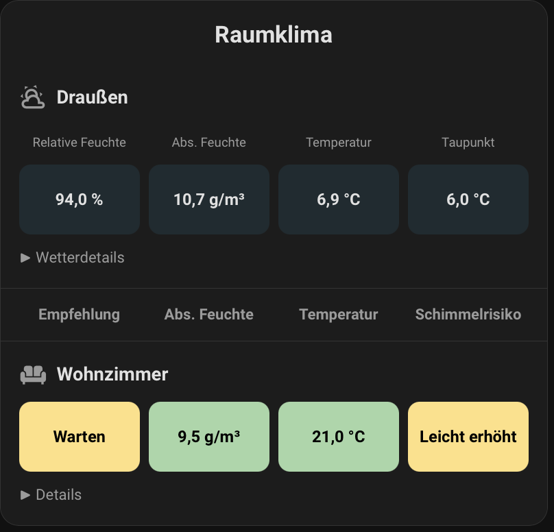

# SHFD FreshAirIQ Room Card

[English](freshairiq-climate-room-card.md) · [Deutsch](de/freshairiq-climate-room-card.md)

Room climate, ventilation recommendations, mould risk and optional outdoor values with an integrated editor.



## Getting started and requirements

Automatic data extraction uses the [FreshAirIQ integration](https://github.com/rupascha/freshairiq) and its action sensor's `freshairiq_room_payload` attribute. Individual readings can be overridden with dedicated sensors. The Climate Card renders its own tiles; for the collection including the regular Room Card, also see its [installation instructions](room-card.md#installation-and-getting-started).

Load the collection entry point as a JavaScript Module: `/hacsfiles/ha-card-collection/ha-card-collection.js`, or manually `/local/ha-card-collection/ha-card-collection.js`. Register no extra editor/appearance file. Select SHFD FreshAirIQ Raumkarte or use:

```yaml
type: custom:shfd-freshairiq-room-card
title: Room climate
rooms:
  - recommendation_entity: sensor.freshairiq_living_room_action
```

Indoor rows show recommendation, absolute humidity, temperature and mould risk. Replace the sample ID with your action sensor. YAML keys are identical in both languages; current editor labels are German.

## Rooms and general options

| Option | Meaning / default |
| --- | --- |
| `rooms` | Indoor room list; assign a FreshAirIQ action sensor under `recommendation_entity` per room |
| `title` | Optional card heading |
| `title_font_size` | 20 px, allowed 10–72 |
| `title_color` | Optional CSS heading color; otherwise theme |
| `neutral_tint_strength` | Neutral tile tint 0–100%, default 12; 0 is transparent |
| `show_header` | Indoor column headings only, default `true` |
| `show_room_heading` | Indoor room icon/name heading, default `true` |
| `details_label_mode` | Label of the collapsible details section, default `auto` |
| `column_labels` | Custom indoor captions; missing or blank text uses defaults |
| `show_details` | Global default for room details, default `true` |
| `hide_missing_details` | Global default: hide missing details, default `true`; `false` shows placeholders |
| `detail_fields` | Global room-detail field selection; can be overridden per room |
| `appearance` | Appearance of this card instance only |

Room options: `recommendation_entity`, optional `name`, `icon`, `temperature_entity`, `absolute_humidity_entity`, `mould_entity`, `humidity_entity`. Room name/icon come from the payload unless overridden. Explicit sensors replace the corresponding payload values. Each room also supports `show_room_heading`, `details_label_mode`, `show_details`, `hide_missing_details` and `detail_fields`. Additional measurement points under `children` remain supported through YAML; without their own overrides they inherit global detail settings, not the parent room's individual settings.

## Global and per-room details

Global settings remain the defaults. Each of the three room options overrides only the corresponding global option; omitting a key means inheritance.

| Room option | Behavior |
| --- | --- |
| `show_details` omitted | Inherit global visibility |
| `show_details: true` | Enable this room's details, even when globally disabled |
| `show_details: false` | Disable this room's details |
| `hide_missing_details` omitted | Inherit global missing-value handling |
| `hide_missing_details: true` / `false` | Hide missing values locally / display placeholders |
| `detail_fields` omitted | Dynamically inherit global field selection |
| `detail_fields: [...]` | Replace the global list with this list; no merging |
| `detail_fields: []` | Explicitly select no fields; no details section is displayed |

```yaml
show_details: true
hide_missing_details: true
detail_fields:
  - reason
  - humidity
  - delta_g_m3
rooms:
  - recommendation_entity: sensor.freshairiq_living_room_action
    name: Living Room
  - recommendation_entity: sensor.freshairiq_bathroom_action
    name: Bathroom
    detail_fields:
      - reason
      - humidity
      - surface_rh
      - moisture_source_message
    hide_missing_details: false
  - recommendation_entity: sensor.freshairiq_basement_action
    name: Basement
    show_details: false
```

Living Room follows all global changes. Bathroom has its own field selection and placeholders but inherits global visibility. Basement has no details. Even when enabled, no details section appears if no displayable fields remain.

Editor path: Innenräume → selected room → Raumdetails. Details anzeigen and Fehlende Detailwerte each offer global inheritance or a local setting. Detailfelder switches between Globale Auswahl verwenden and Eigene Auswahl für diesen Raum. Switching to a custom list copies the current global list; later global list changes do not automatically alter this local list. The local selection can be reset to defaults, select all fields or be cleared.

Globale Einstellungen wieder übernehmen removes only the three local detail options. Room name, action sensor, sensor overrides and global defaults remain unchanged. Opening the editor creates no room overrides.

Default fields without a global or local list: `reason`, `humidity`, `delta_g_m3`, `surface_rh`, `opening_state`, `measurement_frame_reason`. Zero values remain visible. Session values require active ventilation; CO₂ requires an available measurement. These conditions still apply with local selections and placeholders enabled. Outdoor weather details remain independent of indoor room details.

## Room heading and details label

The room heading shows an indoor room's icon and name. It can be shown or hidden globally and per room. The details label is independent.

| Option | Meaning / default |
| --- | --- |
| `show_room_heading` | Show the room heading; default `true` |
| `details_label_mode` | `auto`, `room_name`, `details`, or `auto_hide_empty`; default `auto` |

| Mode | Behavior |
| --- | --- |
| `auto` | `Details` when the room heading is visible, otherwise the room name |
| `room_name` | Always the room name |
| `details` | Always `Details` |
| `auto_hide_empty` | Like `auto`; when the room heading is hidden and no details can be displayed, the fallback room-name row is omitted |

```yaml
show_room_heading: false
details_label_mode: auto_hide_empty
```

For a compact view without room names, set both options. When details are available, the room name remains the collapsible details label. When no details can be displayed, the name row is omitted completely; readings and dividers remain.

Each room can override either option. Omitting a key inherits the global setting. The room heading can remain visible even with `auto_hide_empty`.

```yaml
show_room_heading: false
details_label_mode: auto_hide_empty
rooms:
  - recommendation_entity: sensor.freshairiq_living_room_action
    name: Living Room
  - recommendation_entity: sensor.freshairiq_bathroom_action
    name: Bathroom
    show_room_heading: true
```

Editor paths: General → Room heading and details label for global defaults. Per room: Indoor rooms → selected room → Room heading and details label. Each option can inherit globally or be set locally. “Globale Raumzeilen-Einstellungen übernehmen” removes only the two local overrides.

## Indoor and outdoor column headings

Visibility is independent: `show_header` controls indoors; `outdoor.show_header` controls outdoors. Both default to `true`. Hiding captions removes only column headings, not room/outdoor names, readings or weather details.

```yaml
show_header: true
column_labels:
  recommendation: Ventilation
  absolute_humidity: Abs. humidity
  temperature: Room temperature
  mould: Mould risk
outdoor:
  show_header: true
  column_labels:
    humidity: Humidity
    absolute_humidity: Abs. humidity
    temperature: Outdoor temperature
    dew_point: Dew point
```

| Location | Allowed keys | Default captions |
| --- | --- | --- |
| `column_labels` | `recommendation`, `absolute_humidity`, `temperature`, `mould` | Empfehlung, Abs. Feuchte, Temperatur, Schimmelrisiko |
| `outdoor.column_labels` | `humidity`, `absolute_humidity`, `temperature`, `dew_point` | Relative Feuchte, Abs. Feuchte, Temperatur, Taupunkt |

Missing, empty or whitespace-only captions use defaults. Captions are text and change neither sensor assignment, column order nor colors. Custom captions also appear in tile tooltips and accessible labels.

Indoors: Allgemein → Beschriftungen der Innenspalten. Outdoors: Außenwerte → the respective column group. Each outdoor group pairs Spaltenüberschrift with Sensor-Entität. Standardbeschriftungen wiederherstellen resets captions only; sensors, visibility and weather settings remain unchanged. Captions can be prepared while headings are hidden.

## Outdoor values and weather

```yaml
outdoor:
  name: Outdoor
  icon: mdi:weather-partly-cloudy
  show_header: true
  humidity_entity: sensor.outdoor_humidity
  absolute_humidity_entity: sensor.outdoor_absolute_humidity
  temperature_entity: sensor.outdoor_temperature
  dew_point_entity: sensor.outdoor_dew_point
  column_labels:
    temperature: Outdoor temperature
  weather_entity: weather.home
  show_weather: true
  show_forecast: true
  forecast_type: daily
```

All outdoor sensors are optional; missing/unavailable values display `–`. No dew point is calculated. The correct key is `dew_point_entity`, not `dewpoint_entity`. Without a name, the UI uses Draußen. Pairing fields in the editor does not change the existing YAML structure.

Weather details require `weather_entity`. `show_weather` and `show_forecast` default to `true`. `forecast_type` accepts `daily`, `hourly`, `twice_daily` and must be supported by the weather integration. The weather card loads when outdoor details open, independently of indoor `show_details`.

## Measurement colors

Indoor and outdoor colors can be enabled independently. Indoor colors default to enabled; outdoor colors require explicit activation. Numeric ranges have exactly one base (`above: null`) and unique numeric lower bounds; the highest matching bound is inclusive. An empty color uses neutral tile tint. Disabling colors does not delete rules.

```yaml
color_rules:
  temperature:
    enabled: true
    ranges:
      - above: null
        color: "#90CAF9"
      - above: 18
        color: "#A5D6A7"
      - above: 24
        color: "#FFE082"
    outdoor_enabled: true
    outdoor_ranges:
      - above: null
        color: "#90CAF9"
      - above: 0
        color: "#80DEEA"
```

Other categories: `absolute_humidity`, `relative_humidity`, `dew_point`; state colors for recommendations and mould under `color_rules.recommendation.states` and `color_rules.mould.states`. `relative_humidity` and `dew_point` apply outdoors. Bounds refer to the readings and units used; colors are not health or mould assessments. Quote YAML hex colors. Heading, colors and neutral tint are configured under Allgemein or Farben & Grenzwerte. The color picker with text input is also used for appearance settings.

## Appearance

The same groups as the [Room Card](room-card.md#appearance): spacing, dividers, background, border/corners and shadows. Without `appearance`, existing CSS, theme border/shadow and responsive gaps remain unchanged.

```yaml
appearance:
  padding: 16
  indoor_item_gap: 8
  outdoor_item_gap: 8
  section_spacing: 4
  dividers:
    enabled: true
    width: 1
    color: "var(--divider-color)"
  background:
    mode: theme
  border:
    enabled: true
    width: 1
    color: "rgba(255,255,255,0.20)"
    radius: 18
  shadow:
    mode: soft
```

| Option | Meaning / previous default |
| --- | --- |
| `padding` | Room/outdoor-row padding; 16 px, mobile 12 px. Heading/column labels receive the same horizontal inset |
| `indoor_item_gap` | Indoor tile gaps and matching column headings; 8 px, mobile 5 px |
| `outdoor_item_gap` | Outdoor tile gaps; 8 px, mobile 5 px |
| `item_gap` | Shared YAML fallback; indoor/outdoor values take precedence |
| `section_spacing` | Extra row spacing; default 0 in addition to existing padding; extra measurement points add it to their previous 14 px |
| `dividers.enabled`, `.width`, `.color` | Visible by default, 1 px, theme `--divider-color` |
| `background.mode`, `.color` | `theme`, `transparent`, `custom`; custom requires a color |
| `border.enabled`, `.width`, `.color` | Theme border unless overridden; custom border defaults to 1 px and theme color |
| `border.radius` | Theme radius unless overridden; fallback 16 px |
| `shadow.mode`, `.value` | `default` retains theme shadow; further modes below |

Explicit gaps apply at all screen sizes; omitted settings retain responsive behavior. Spacing/radius: 0–100 px; border/divider widths: 0–10 px. `0` is valid. Unlike the Room Card, `section_spacing` here adds spacing rather than replacing legacy section spacing. Room Card keys `status_item_gap`/`device_item_gap` do not apply here; use `indoor_item_gap`/`outdoor_item_gap`.

Use Darstellung übernehmen to apply appearance changes. Opening the editor does not persist displayed defaults. Standardabstände wiederherstellen resets spacing only. Darstellung auf Standard zurücksetzen removes only `appearance`; rooms, outdoor sensors, global/local details, captions, ranges and neutral tint remain. Background options affect only the outer surface, not colored or neutrally tinted tiles. Border behavior can return to the theme independently of radius.

### Shadows

| Mode | CSS value |
| --- | --- |
| `default` | Unchanged theme shadow; may be invisible depending on theme |
| `none` | No shadow |
| `subtle` | `0 1px 3px rgba(0, 0, 0, 0.18)` |
| `soft` | `0 4px 12px rgba(0, 0, 0, 0.22)` |
| `strong` | `0 8px 24px rgba(0, 0, 0, 0.30)` |
| `floating` | `0 12px 32px rgba(0, 0, 0, 0.35)` |
| `custom` | A valid CSS value in `shadow.value` |

The four presets match the Room Card, while `default` preserves each card's own previous behavior. Als eigenen Schatten bearbeiten copies a preset into the editable field. Example: `shadow: {mode: custom, value: "0 4px 16px rgba(0,0,0,0.25)"}`. Enter a value, not a CSS rule or semicolons. Test with border disabled and compare `none`/`floating`. Shadows extend outside; padding does not add exterior space and parent containers can clip them.

## Full example

```yaml
type: custom:shfd-freshairiq-room-card
title: Room climate
neutral_tint_strength: 12
show_header: true
show_room_heading: false
details_label_mode: auto_hide_empty
show_details: true
hide_missing_details: true
detail_fields:
  - reason
  - humidity
column_labels:
  recommendation: Ventilation
rooms:
  - recommendation_entity: sensor.freshairiq_living_room_action
    name: Living Room
  - recommendation_entity: sensor.freshairiq_bathroom_action
    name: Bathroom
    detail_fields:
      - reason
      - surface_rh
outdoor:
  temperature_entity: sensor.outdoor_temperature
  humidity_entity: sensor.outdoor_humidity
  show_header: true
  column_labels:
    temperature: Outdoor temperature
  weather_entity: weather.home
appearance:
  indoor_item_gap: 10
  outdoor_item_gap: 10
  shadow:
    mode: soft
```

## Interaction and troubleshooting

- Missing changes: use the relevant apply button, reload the complete browser page and check cache.
- Global detail change does not affect a room: check its override or choose Globale Einstellungen wieder übernehmen.
- No details: check `show_details`, empty field selections, missing data and conditional fields.
- Room name remains visible despite `auto_hide_empty`: `show_room_heading` must also be `false`; check local room overrides.
- No headings: check `show_header` and `outdoor.show_header` independently; blank text does not hide a heading.
- Missing readings: check action sensor/payload and sensor assignments. Weather issues: check integration, forecast type and outdoor details.
- Payload-derived values still open the action sensor's more-info dialog; explicitly configured sensors open their own dialog. Automatic resolution of separate detail targets is not implemented yet.
- Appearance options change neither entity states nor FreshAirIQ calculations. Existing configurations without new options keep their previous behavior.
